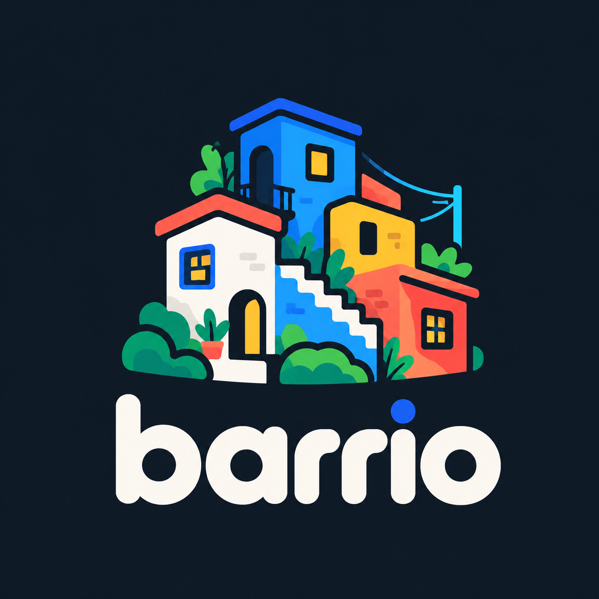
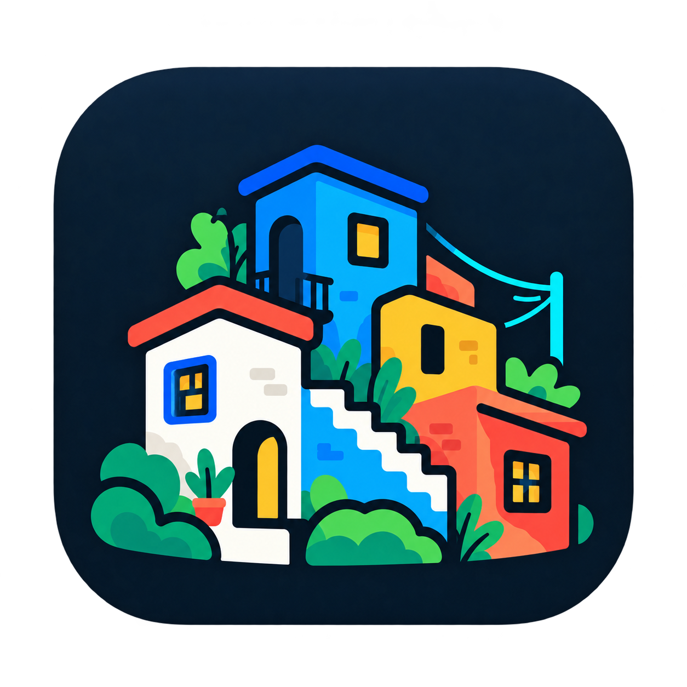

# Barrio visual identity and design system

Version 1.0. Proposed design direction.

Barrio is an open-source, public-interest software organization at `barrio.works`.
This document is the source of truth for its first logo explorations and UI implementation.
The identity includes a concept brief, design tokens, and the supplied logo artwork below. Simplified logo variants and components still need design and validation.

## Mission

Barrio builds free, open-source software for everyday life and the public good.
Its products respect privacy, avoid advertising and data exploitation, and remain accessible regardless of a person's ability to donate.
The software welcomes ordinary people, including those without technical experience.

The organization has a shared identity across a proposed family of applications.

| Product | Domain | Purpose | Principal accent |
| --- | --- | --- | --- |
| Barrio Places | `places.barrio.works` | Privacy-first location sharing | Cable Sky, `#20B8DB` |
| Barrio Home | `home.barrio.works` | Family and household organization | Sunflower, `#FFCB36` |
| Barrio Impact | `impact.barrio.works` | Evidence and impact reporting | Hillside Green, `#168667` |
| Barrio Civic | `civic.barrio.works` | Accessible public information | Mural Coral, `#F05D50` |

These product descriptions are identity proposals, not claims of available applications.

## Creative direction

"A neighborhood is built one useful piece at a time. So is good software."

Medellín's colorful hillside neighborhoods meet the playful construction language of Townscaper and Dorfromantik.
Barrio looks like a small, independent public-interest organization that cares deeply about design.
The identity is colorful and cartoonish, with the credibility required for privacy-sensitive software.

The central visual idea is a neighborhood built from small, interconnected pieces.
The logo establishes the shapes. The neighborhood establishes the visual language. The software remains simple.
This idea connects the logo, website, application interfaces, illustrations, icons, and motion.

Cobalt blue and charcoal anchor the system. Other saturated colors form a shared neighborhood palette.
Blue remains the permanent Barrio brand color across the website, GitHub identity, logo explorations, and products.

## Visual references and cultural context

These references describe qualities to study. They do not authorize copying another artist's or organization's assets.

| Reference | Qualities to study |
| --- | --- |
| Medellín hillside architecture | Stacked buildings, painted facades, visible brickwork, stairs, windows, balconies, greenery, and connections between homes. |
| Comuna 13 community art | Saturated pigments, bold outlines, vivid contrasts, and collaborative public spaces. |
| Townscaper | Toy-like architecture, modular composition, playful irregularity, connected houses, arches, stairs, and varied rooftops. |
| Dorfromantik | Readable miniatures, coherent color families, limited shape vocabularies, and satisfying assembly. |
| Framasoft | Friendly public-interest communication, approachable illustration, independent identity, and commitment to open software. |

Comuna 13's public art and pedestrian infrastructure belong to a specific history of community organizing and social transformation.
Draw from the architecture and creative energy without reducing that history to decorative graffiti.
Do not copy specific murals, exploit the area's history, or use generic street-art decoration.
Create original illustrations rather than imitating particular game assets or another organization's brand.

The supplied visual reference links are retained below. They are image references, not verified source articles.

- [Medellín hillside architecture, supplied as "Social Urbanism in Colombia"](https://images.openai.com/static-rsc-4/uEMLSzzx2PxExVBpSqha9vE2BH14986XwzWoxmsp9cv4w4PyFnb0y2deveiFgPsQ3K4xaEjAYyTPnfoq_tMRPxZgx3sGJOBlVjqN8AoZh0osNg-aqvq5OoeUtewu56pgaqt7tNkpgxRxaXgDmHBBXCM7jEZywfvlHuSvmrGgrVM?purpose=inline).
- [Comuna 13 murals, supplied as "Comuna 13: How Medellin's Most Infamous Community Reinvented Itself"](https://images.openai.com/static-rsc-4/fOjSPBbnu1GjwsTMmjrpheytFuK1c7isivzHhD991v4DQ3Ut8ejwR--6k38Adg59YJ86lsiHcZusZNjQ4sW3xX_flgATPt5zGTzgy5XesyrbOMGX-ky0Cq3KjUo-6UxImCVg0INEo8CZcaFnh4Z3XPl5uyrprMQyQWdY6b_TVzA?purpose=inline).
- [Townscaper, supplied as a relaxing-games article image](https://images.openai.com/static-rsc-4/jPsMCrm9IChKtfQDSjezxaqp7biWVRO0F4_Joh4DbhwsG6JnxlR_xZlfwTOS549JXmWppUdAHEHQ_ncPL6Vt9kAIixLw-CzBjKoyp1S0uaxA1uVIXnmYTUGi3Rg3suq6e_SIJlQr_TiGKc4Xw_u0p4Da-tz7xYLTysLRu7BwS5g?purpose=inline).
- [Dorfromantik, supplied visual reference](https://images.openai.com/static-rsc-4/3M5ktdrmpI2ZQdGyR2zWLIg_CpOl9_YX3Oo-UZ3ejT7Yn32RAvoTXpORZSQCDjKiGKyboWF8_2T7gWHsWk1x-IspxSyMtC2HORIMJ4bVFwIAzkY8Vm8hnek1wv4067_PMVo5TpUDxCdkA6QtmCQEeVySr5lJI0xLXLE58rNmJP8?purpose=inline).

## Logo

### Supplied artwork

The following assets document the supplied visual direction. Documentation previews use optimized WebP files, with PNG downloads available.

#### Logo on a dark background



[Download the dark-background logo](docs/assets/barrio-dark-background.png).

#### App icon



The icon has a transparent exterior. White building facades and stairs are part of the artwork.

[Download the app icon](docs/assets/barrio-icon.png).

### Logo requirements

Explore a compact neighborhood symbol with three interconnected buildings on a gentle hillside.
A stairway or path connects the buildings.
Use a lowercase `barrio` wordmark with friendly, confident typography.

The mark has the following requirements.

- Recognizable at 24px.
- Effective as a single-color silhouette.
- Cartoonish but geometrically controlled.
- Slightly asymmetrical, with rounded architectural shapes.
- Bold, readable outlines.
- Recognizable without fine detail.
- Usable in light and dark modes.
- Recognizable independently of the wordmark.

Required versions include horizontal, stacked, icon-only, simplified, and monochrome marks.
A neighborhood cat inspired by the founder's pet may appear as a secondary mascot.
The cat must not dominate the principal logo.

## Color system

These proposed brand colors draw inspiration from the references. They are not sampled official colors of Medellín.
Use strong chromatic contrast and clean, cool neutrals.

### Core palette

| Name | Value | Role |
| --- | --- | --- |
| Barrio Blue | `#245BEB` | Permanent brand color and primary action color in light mode. |
| Mural Coral | `#F05D50` | Shared accent and Civic identity. |
| Sunflower | `#FFCB36` | Shared accent and Home identity. |
| Hillside Green | `#168667` | Shared accent and Impact identity. |
| Cable Sky | `#20B8DB` | Shared accent and Places identity. |
| Mural Violet | `#8457D8` | Shared accent. |
| Brick Orange | `#D96A37` | Shared accent. |
| Night Charcoal | `#17212F` | Primary light-mode text and brand anchor. |
| Clean White | `#FFFFFF` | Main light background. |

### Neutral foundations

| Name | Value | Intended use |
| --- | --- | --- |
| Canvas | `#FFFFFF` | Main light background. |
| Cloud | `#F4F7FB` | Secondary surfaces. |
| Mist | `#E8EEF5` | Palette color for borders and dividers. |
| Slate | `#607086` | Palette color for secondary text. |
| Charcoal | `#17212F` | Primary text. |
| Deep Night | `#101824` | Dark background. |

Palette swatches and functional tokens have distinct roles.
The light-mode secondary-text token is `#53647B`, and the default-border token is `#D9E2ED`.
Preserve those supplied functional values rather than replacing them with Slate or Mist.

### Color allocation

| Context | Allocation |
| --- | --- |
| Main application UI | 75% neutral, 20% primary or accent, 5% illustration. |
| Marketing pages | 55% neutral, 45% brand colors and illustrations. |
| Brand artwork | Full palette available, limited to 4 or 5 colors per composition. |
| Tables and data visualizations | Semantic data colors rather than arbitrary decoration. |

The full palette is available for illustrations, product icons, and decorative neighborhood compositions.
Application interfaces use fewer colors. Every screen does not need every brand color.
"Build", "Share", "Care", and "Grow" are examples of short brand language for expressive compositions.

Avoid large text blocks on coral or yellow.
Check each functional foreground and background pairing against WCAG AA.
Normal text requires 4.5:1 contrast. Large text and essential graphical objects require 3:1 contrast.
The token definitions alone do not establish compliance.

No cream, beige, parchment, sepia, warm off-white, or desaturated yellow neutral backgrounds.
Avoid washed-out pastels and default SaaS gradients.

## Product identity

All applications inherit the Barrio logo, wordmark, typography, layout, components, illustration grammar, and foundational colors.
Only the identifying product accent changes, as specified in the product table.
Use that accent in marketing, app icons, and selected highlights.

Product accents are decorative identity colors.
They must not change the meanings of success, warning, danger, or privacy states.
Any early product icons are placeholders until the custom Barrio icon system exists.

## Typography

Three type roles belong to one identity.

| Role | Typeface | Use |
| --- | --- | --- |
| Display | Fraunces | Expressive brand headlines, campaigns, and marketing. |
| Interface | Nunito Sans | Navigation, forms, buttons, body text, and everyday product tasks. |
| Technical | IBM Plex Mono | Code, coordinates, identifiers, and development documentation. |

Fraunces is the proposed soft, expressive display serif.
Nunito Sans provides a readable humanist interface with warmth.
Monospace stays limited to technical information that helps the reader.
Ordinary users should not have to read technical-looking UI text for everyday tasks.

Representative hierarchy and copy follow.

- Display headline, "Good software belongs to everyone."
- Interface heading, "Your neighborhood, your privacy."
- Interface body, "Create a sharing session and choose who can see your location."
- Technical information, `places.barrio.works` and `Last location update: 14:32`.

### Responsive type scale

| Role | Desktop | Mobile | Weight |
| --- | --- | --- | --- |
| Hero display | 64px | 40px | 650 to 750 |
| Page title | 36px | 30px | 700 |
| Section title | 26px | 23px | 700 |
| Card title | 19px | 18px | 700 |
| Body | 16px | 16px | 400 |
| Supporting text | 14px | 14px | 400 to 500 |
| Small metadata | 12px | 12px | 500 |

Default line height is 1.5 for prose and 1.15 to 1.25 for titles.
Use sentence case. Avoid all-uppercase navigation, artificial letter spacing, and thin weights on colorful backgrounds.
Decorative typography belongs outside everyday task controls.

## UI design tokens

These tokens are starting values for a shared technical foundation across applications.
Validate contrast, touch sizes, and focus behavior against actual components.

### Light mode and font families

```css
:root {
  color-scheme: light;

  /* Brand */
  --brand-primary: #245BEB;
  --brand-coral: #F05D50;
  --brand-yellow: #FFCB36;
  --brand-green: #168667;
  --brand-sky: #20B8DB;
  --brand-violet: #8457D8;
  --brand-brick: #D96A37;

  /* Surfaces */
  --surface-canvas: #FFFFFF;
  --surface-subtle: #F4F7FB;
  --surface-raised: #FFFFFF;
  --surface-overlay: #FFFFFF;

  /* Typography */
  --text-primary: #17212F;
  --text-secondary: #53647B;
  --text-inverse: #FFFFFF;

  /* Borders */
  --border-default: #D9E2ED;
  --border-strong: #A8B8CA;

  /* Actions */
  --action-primary: #245BEB;
  --action-hover: #1948C3;
  --action-pressed: #15399A;
  --action-text: #FFFFFF;

  /* Semantic colors */
  --state-success: #11734F;
  --state-warning: #A85A00;
  --state-danger: #B42336;
  --state-info: #245BEB;

  --focus-ring: #245BEB;

  /* Typography */
  --font-display: "Fraunces", Georgia, serif;
  --font-body: "Nunito Sans", Arial, sans-serif;
  --font-mono: "IBM Plex Mono", monospace;
}
```

### Dark mode

```css
[data-theme="dark"] {
  color-scheme: dark;

  --surface-canvas: #101824;
  --surface-subtle: #172334;
  --surface-raised: #213047;
  --surface-overlay: #283A53;

  --text-primary: #F6F9FC;
  --text-secondary: #B9C9DC;
  --text-inverse: #101824;

  --border-default: #35465E;
  --border-strong: #60758F;

  --action-primary: #83A7FF;
  --action-hover: #A0BBFF;
  --action-pressed: #6B95F4;
  --action-text: #101824;

  --state-success: #67D8A4;
  --state-warning: #F5BA66;
  --state-danger: #FF8997;
  --state-info: #83A7FF;

  --focus-ring: #83A7FF;
}
```

Dark mode preserves saturated brand colors within readable, cool surfaces.
Avoid a black-and-neon developer-dashboard aesthetic.

### Geometry, layout, and motion

```css
:root {
  /* Radius */
  --radius-xs: 6px;
  --radius-sm: 10px;
  --radius-md: 14px;
  --radius-lg: 20px;
  --radius-xl: 28px;
  --radius-pill: 999px;

  /* Spacing: 4px base */
  --space-1: 4px;
  --space-2: 8px;
  --space-3: 12px;
  --space-4: 16px;
  --space-5: 20px;
  --space-6: 24px;
  --space-8: 32px;
  --space-10: 40px;
  --space-12: 48px;
  --space-16: 64px;

  /* Layout */
  --container-wide: 1200px;
  --container-reading: 720px;
  --header-height: 72px;
  --control-height: 44px;
  --touch-target-min: 44px;

  /* Motion */
  --duration-fast: 120ms;
  --duration-normal: 200ms;
  --duration-emphasis: 320ms;
  --ease-standard: cubic-bezier(.2, 0, 0, 1);

  /* Shadows */
  --shadow-card: 0 3px 12px rgba(16,24,36,.07);
  --shadow-popover: 0 12px 36px rgba(16,24,36,.14);
}
```

## Shape and component language

Derive the shape vocabulary from the logo.
Use rooftops, simple pitched shapes, stacked blocks, stair-step silhouettes, square and rounded windows, doorways, arches, connected paths, and modular tile-like groups.
Use that geometry consistently in icons, illustrations, landing pages, and product identities.
Standard controls keep familiar interactions.

The component mood combines readable text, rounded shapes, generous spacing, and restrained UI color.
Representative marketing copy includes "Welcome to Barrio", "Everything you need, and nothing you don't", "Get started", "See the projects", "Open source", and "Free for everyone".

### Component rules

- Buttons use rounded rectangles. Avoid exaggerated capsules throughout the UI. Use one strong primary action per screen.
- Cards use rounded corners, light elevation, and clear boundaries. Irregular shapes belong in illustrations rather than form layouts.
- Forms use persistent labels, visible keyboard focus, plain-language validation, and large touch targets.
- The organization website uses simple top navigation. Each product's workflow determines its navigation.
- Charts and maps prioritize interpretation and accessibility. Decorative murals must never obscure information.

The shared accessible component library includes the following components.

- Buttons and links.
- Inputs, textareas, and selects.
- Cards and panels.
- Dialogs and popovers.
- Navigation.
- Tables and filtering.
- Accessible charts.
- Loading, error, and empty states.
- Notifications and confirmation states.
- Privacy and permission controls.

Keep spacing, radii, typography, shadows, and keyboard behavior consistent.
Prioritize predictable navigation and low cognitive load.
Avoid dashboard clutter, excessive sidebars, nested settings screens, and decoration that interferes with tasks.

### Signature motif, the steps

An abstract three-step silhouette refers to hillside streets.
It can appear in onboarding progress, illustrated dividers, transitions, and stacked feature cards.
The motif provides visual continuity without replacing established interaction patterns.
Do not turn every navigation control into a staircase.

## Illustration and motion

Create an original illustrated world of simplified buildings, rooftops, hills, plants, paths, windows, transport infrastructure, and occasional neighborhood characters.
Use a limited number of colors in each illustration.
The style combines modern editorial cartoons, friendly public-interest communication, and miniature neighborhood-building games.

| Context | Illustration approach |
| --- | --- |
| Marketing | Panoramic neighborhoods, plants, rooftops, stairs, transit, and people. |
| Empty states | One simple vignette and a clear next action. |
| Onboarding | Small modular illustrations that introduce the product. |
| Donations | Collective support without guilt or emotional manipulation. |
| Sensitive flows | Minimal decoration and no celebratory animation for sharing private data or reviewing personal information. |

Motion borrows the satisfaction of assembly without distracting gameplay mechanics.
After a meaningful, non-sensitive action, individual pieces can briefly come together like a neighborhood block finding its place.
Favor short sequences, blocks settling into place, gentle hover movement, and smooth transitions between related screens.

Honor reduced-motion settings.
Avoid gratuitous animation, parallax-heavy forms, and constant movement.
Never introduce playful motion into safety-critical or sensitive privacy interactions.

## Brand voice

Write clearly and directly, without corporate jargon.
The voice is friendly, principled, optimistic, helpful, and transparent about limitations.
Avoid childish language, preaching, exaggeration, and patronizing explanations.

Preferred phrases include the following.

- "Free software for everyone."
- "Your data belongs to you."
- "Useful things, built together."

Avoid the following phrases.

- "Revolutionizing communities with innovative solutions."
- "Empowering stakeholders through next-generation technology."

## Accessibility and privacy

Target WCAG 2.2 AA.
Provide visible focus states, keyboard navigation, readable text, touch-friendly controls, and reduced-motion support.
Layouts must work at 200% zoom.
Never convey meaning through color alone.

Privacy features must be understandable before activation.
Inactive location sharing must never look active.
Outdated locations must never look current.
Product identity colors must preserve consistent meanings for status and privacy information.

## Deliverables and validation

The following deliverables remain to be designed and tested.

1. Primary logo, simplified mark, monochrome variants, and wordmark.
2. Brand palette and semantic color system, validated in use.
3. Typography and responsive type scale, validated with the selected fonts.
4. Spacing, radius, motion, elevation, and layout tokens, validated in components.
5. Shared accessible UI component library.
6. Original icon and illustration guidelines.
7. Product identities for Places, Home, Civic, and Impact.
8. Desktop and mobile landing-page concepts.
9. One complete representative product screen.
10. A reusable brand guide with examples of correct and incorrect usage.

### Examples of correct and incorrect usage

These written examples guide the first implementation. Visual examples remain part of the deliverables.

| Correct | Incorrect |
| --- | --- |
| Blue provides a consistent organizational identity while product accents identify applications. | Each application replaces the Barrio identity with an unrelated palette. |
| Clean white and cool gray surfaces support a few saturated accents. | Cream backgrounds, washed-out pastels, or every brand color on every screen. |
| Semantic colors communicate status consistently, with text or icons as additional cues. | Yellow means Home in one place and silently changes the meaning of a warning elsewhere. |
| Neighborhood geometry appears in illustrations and selected brand details. | Staircase-shaped navigation and irregular form controls make tasks harder. |
| Privacy controls clearly distinguish inactive sharing and outdated locations. | Decorative color or animation implies that inactive sharing is active or stale data is current. |
| Original architecture and illustration respect the references' cultural context. | Copied murals, game assets, or generic graffiti replace an original identity. |

### Acceptance criteria

- The brand remains identifiable when decorative color is removed.
- The UI remains usable when every illustration is removed.
- The logo remains recognizable at 24px and as a single-color silhouette.
- Functional color combinations pass their applicable contrast requirements.
- Components support keyboard navigation, visible focus, readable text, and touch targets.
- Layouts work at 200% zoom and respect reduced-motion preferences.
- Privacy states remain clear before activation and during use.
- The system feels expressive without making navigation difficult.
- The result reads as an independent public-interest software organization with a distinctive cultural identity.

The next design work starts with logo explorations and actual components using this brief.
