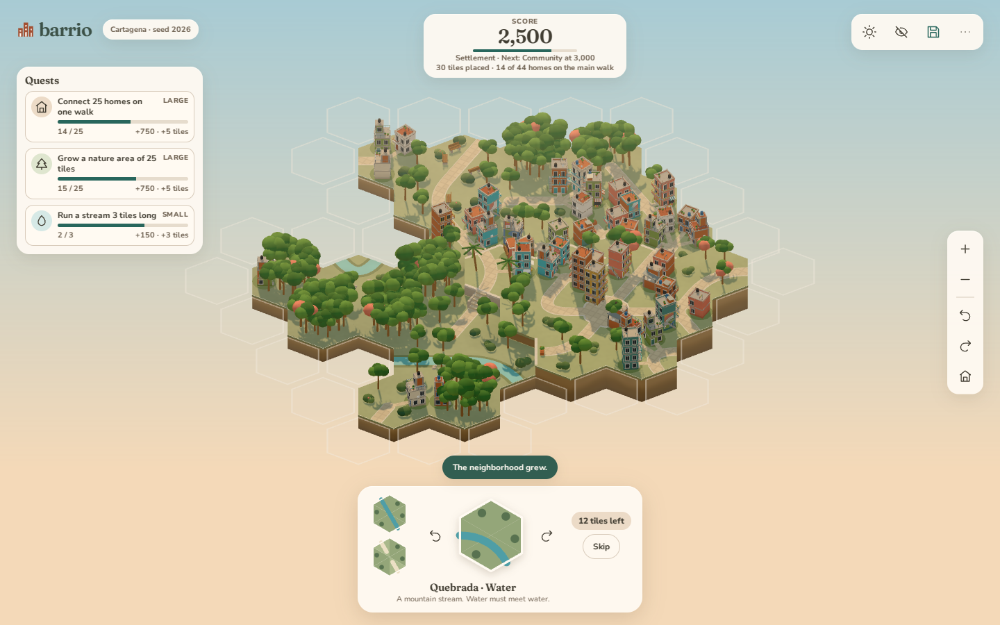
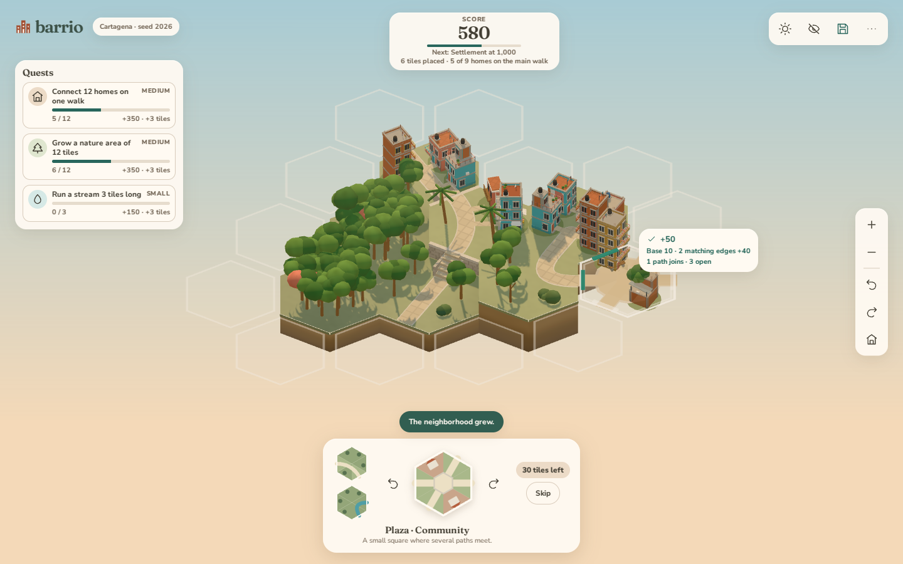
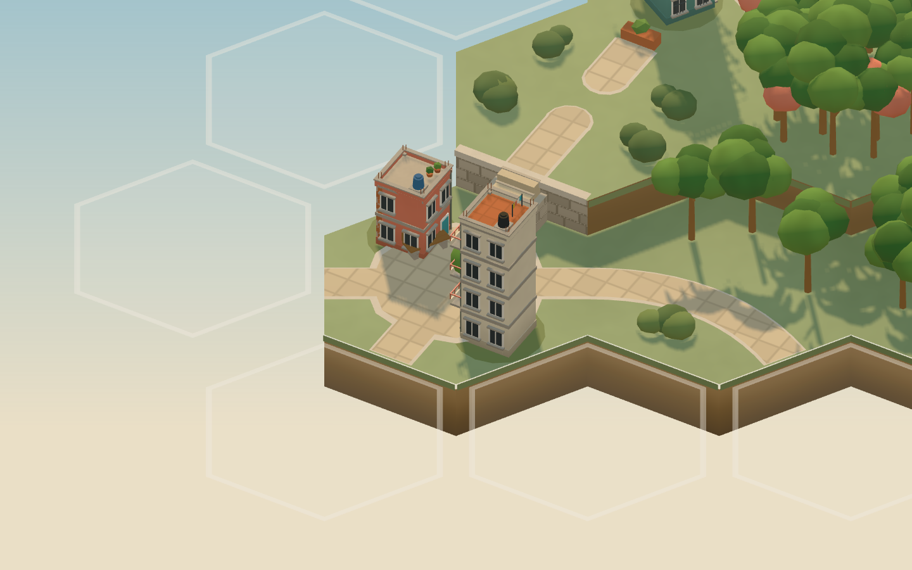

<h1 align="center">Hillside</h1>

<p align="center">
  Grow a Colombian hillside neighborhood one hexagon at a time.<br>
  A relaxing tile-placement game that runs in your browser.
</p>

<p align="center">
  <a href="https://hillside.barrio.works">Play</a> ·
  <a href="#how-a-run-works">How a run works</a> ·
  <a href="docs/classic-gameplay.md">Rules</a> ·
  <a href="#run-locally">Run locally</a>
</p>

<p align="center">
  <a href="LICENSE"></a>
  <a href="crates/barrio-core"></a>
  <a href="PRODUCT.md"></a>
</p>



Hillside is a game about building a Medellín-style barrio on a terraced hillside. Each hexagonal tile carries homes, paths, gardens, or a stream. You fit its six edges to the neighborhood, join paths with stairs across terraces, and watch an irregular little island grow.

Play at [hillside.barrio.works](https://hillside.barrio.works), or run the source locally. The browser runs the complete game. Hillside has no account system, no advertising, and no game server. It is part of [Barrio](https://barrio.works), which builds free, open-source software for everyday life.

## How a run works

A run starts with one settlement in a Colombian region (Medellín, Salento, Cartagena, or Bogotá) and a deck of 30 tiles. The bottom tray shows the tile in hand, the next two tiles, and the number of tiles left.

- **Place a tile.** Outlined spots beside the neighborhood show where the tile in hand fits. Dashed rims mark spots where it fits in no rotation. Point at a spot to preview the tile and its points, then click to place it. On a touch screen, tap to preview and tap again to place.
- **Score matching edges.** Every tile scores 10, plus 20 for each edge that matches its neighbor. A filled spot whose six edges all match adds 60.
- **Keep water together.** Streams must meet streams, and land may not touch water. A stream may end at an empty spot.
- **Connect the homes.** Matching path edges join walks, with stairs across one terrace. Two terraces is too steep, so the path stops at a railing. A home counts once a path reaches its door.
- **Skip once.** Once per run, you can send the tile in hand to the back of the deck.
- **Complete quests.** Three quests ask for homes on one walk, a large nature area, and a long stream. A completed quest pays points and adds tiles to the deck. The next, larger quest of the same kind takes its place.
- **Reach the milestones.** Milestones come at 1,000, 3,000, and 6,000 points. At 6,000 you win, and you can keep building or finish and see the results.

The run ends when the deck is empty. Hillside keeps your personal bests on this device. There is no undo.

<p align="center">
  
  
</p>

[Classic gameplay](docs/classic-gameplay.md) specifies every rule.

## Play your first run

1. Open [hillside.barrio.works](https://hillside.barrio.works) in a browser with WebGL.
2. Read the three quests, then point at an outlined spot to preview the tile in hand.
3. Press `R` until the edges match, then click to place the tile.

Hillside saves your run in the browser as you play. To play a specific run without touching your autosave, add `?seed=<number>` to the address. To watch the built-in greedy player, also add `&autoplay=<count>`.

| Key or gesture | Action |
| --- | --- |
| `R`, `Shift R` | Turn the tile, turn it back |
| `S` | Skip the tile in hand |
| Arrow keys, `Enter` | Move between open spots and place, with the canvas focused |
| `Q`, `E` | Turn the view |
| Drag, right-drag, scroll | Orbit, pan, zoom |
| `H` | Hide the interface |
| `?` | Open help |
| `Ctrl S` (`Command S` on macOS) | Save |

The house button frames the neighborhood. The sun button changes the lighting. The neighborhood menu loads, exports, and imports runs, mutes sound, and starts a new game.

## Save your runs

Runs stay in browser-local storage. The browser or operating system can clear that storage, so export a JSON file of any run that matters. An exported file also moves a run between browsers.

A save file (version 3) holds the seed, the rules version (`classic-2`), and the list of placements and skips. Loading replays every action through the rules. A file restores the exact run, or Hillside refuses it and keeps the current run.

Classic cannot play saves from earlier versions (the square sandbox, version 1, and free hex building, version 2). Loading one explains why and changes nothing. If this browser still holds one, or holds an autosave this version could not read, the menu offers to download it.

## Run locally

Install Node.js 22.12 or newer, a stable [Rust toolchain through rustup](https://rustup.rs/), and wasm-pack, then run:

```sh
git clone https://github.com/BarrioWorks/hillside.git
cd hillside
rustup target add wasm32-unknown-unknown
cargo install wasm-pack --locked
npm ci
npm run build:wasm
npm run dev
```

Open <http://localhost:5173>. `npm run dev` serves the WASM files that `npm run build:wasm` generated. After you change the Rust core, run `npm run build:wasm` again.

Rust compiled to WebAssembly owns the deterministic parts of the game: hex terrain, tile supply, placement rules, path networks, history, and save validation. Three.js renders the world, and TypeScript handles input and the interface.

## Development

Run the checks before you commit:

```sh
cargo fmt --all -- --check
cargo clippy --workspace --all-targets -- -D warnings
cargo test --workspace
npm run check
npm run build
node tools/verify-wasm.mjs
npx playwright install chromium
npm run test:e2e
```

`npm run check` runs the TypeScript type check, Biome, and Vitest. `npm run build` writes the production build to `dist/`, and `npm run preview` serves it.

| Read | For |
| --- | --- |
| [Classic gameplay](docs/classic-gameplay.md) | Rules, scoring, quests, and balance |
| [Architecture](docs/architecture.md) | Runtime modules and data flow |
| [Implementation contract](docs/implementation-contract.md) | Constraints to keep when you extend the system |
| [Strategy redesign](docs/strategy-redesign.md) | Research, decisions, and phases of the hex redesign |
| [Visual redesign](docs/visual-redesign.md) | The Medellín hillside look, with [before and after comparisons](docs/screenshots/compare/) |
| [Performance](docs/performance.md) | Measurement method and results |
| [Research ledger](docs/research-ledger.md), [visual research ledger](docs/visual-research-ledger.md) | Sources and what each changed |
| [Open-source research](docs/open-source-research.md), [visual reference analysis](docs/visual-reference-analysis.md) | Prior art and reference studies |
| [DESIGN.md](DESIGN.md), [BRAND.md](BRAND.md) | Hillside's visual direction and tokens, and the Barrio identity |
| [Asset provenance](docs/asset-manifest.md) | The Kenney source models in `asset-sources/` |

<details>
<summary>Project structure</summary>

- `crates/barrio-core/` holds the hex grid, tile edges and placement rules, the seeded hillside and tile supply, path networks, save validation, and the native Rust tests.
- `web/src/` holds interaction, the WASM boundary, rendering, sound, persistence, and the interface.
- `web/src/render/` builds the hex ground (`ground.ts`) and lays out each tile's houses, paths, stairs, streams, and trees (`tiles.ts`). `architecture.ts` generates every building from a shape grammar. All of them share one procedural material (`material.ts`) and one palette (`palette.ts`).
- `asset-sources/` keeps the Kenney source models from the prototype, with licenses and provenance. The runtime loads no GLB models.
- `tools/` holds the WASM build, the benchmarks, WASM verification, and the screenshot capture tool.
- `docs/` records the architecture, research, decisions, and measured performance.

</details>

<details>
<summary>Graphics quality</summary>

Hillside has two quality tiers. Software renderers such as SwiftShader and llvmpipe get the low tier automatically.

| | Low | High |
| --- | --- | --- |
| Pixel ratio | 1 | Up to 2 |
| Shadows | 1024 px PCF | 2048 px soft |
| Brick, stone, and paving patterns | Off | On |

To choose a tier, add `?quality=low` or `?quality=high` to the address.

</details>

<details>
<summary>Benchmarks and screenshots</summary>

Start a server, then run `node tools/benchmark.mjs`. It measures the one-tile opening and runs grown by 10, 20, and 30 placements. For each, it reports render cost per frame, draw calls, triangles, renderer memory, scene build time, and placement latency, plus renderer memory after ten regrown runs. `BARRIO_QUALITY` sets the tier to `low` or `high`, and `BARRIO_BENCHMARK_OUT` sets the output file.

`node tools/benchmark-core.mjs` times the release WASM rules on their own. This command plays 1,000 seeded runs with each of five computer players through the real rules, and reports scores, quests, run length, and victory rates:

```sh
cargo run --release --bin simulate -- --seeds 1000 --out docs/benchmarks/classic-balance.json
```

[Classic gameplay, Balance](docs/classic-gameplay.md#45-balance) discusses the results. The benchmark scripts force SwiftShader software rendering, so their numbers do not set desktop or mobile targets. [Performance](docs/performance.md) describes the method.

`tools/capture.mjs` renders the documentation screenshots in the real engine. The shots cover the four regional starts, hover and invalid previews, 10- and 30-tile neighborhoods, and path evidence. Each path shot searches seeded runs for the situation it shows: two joined homes tiles, a three-way crossing, hillside stairs, and two walks before and after they join.

```sh
BARRIO_URL=http://127.0.0.1:5173 BARRIO_BROWSER_PATH=/path/to/chrome node tools/capture.mjs <outdir> [shot,shot]
```

The optional second argument limits the run to named shots, for example `06-hover-preview,14-hillside-stairs`. Each shot writes a PNG and a JSON file of renderer metrics.

</details>

## License

Hillside's source code uses the [MIT license](LICENSE), matching the Rust crate's license declaration. Fonts and the archived source models keep their own licenses. The runtime ships the Three.js, Zod, Fraunces, and Nunito Sans notices under `licenses/`. Reference photographs and upstream research excerpts stay out of the web build.
